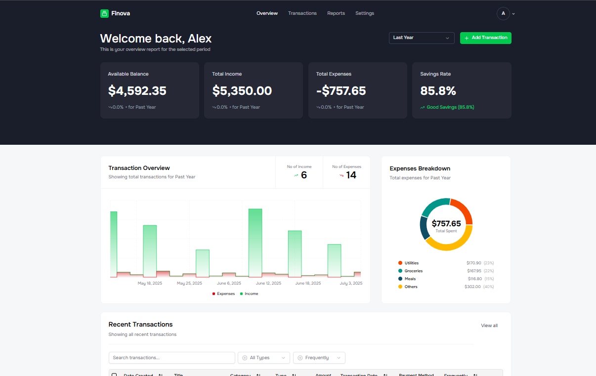

# 💸 Finova.AI — AI-Powered Finance SaaS

A full-stack personal finance SaaS that helps users track income and expenses, understand their spending through an analytics dashboard, and get AI-generated insights. It includes AI receipt scanning, recurring transactions, scheduled monthly email reports, and a Pro subscription tier billed through Razorpay.

## ✨ Features

- 🔐 **Secure Authentication** — JWT access and refresh tokens with Passport, protected routes, and auto-logout on token expiry
- 💳 **Pro Subscriptions (Razorpay)** — Recurring monthly billing with server-side payment signature verification, signed webhooks, and idempotent event handling
- 🧾 **AI Receipt Scanning (Pro)** — Upload a receipt image and Google Gemini extracts the amount, date, merchant, and category into a ready-to-save transaction
- 📊 **Analytics Dashboard** — Income, expense, and balance summaries with period-over-period change, trend charts, and an expense breakdown by category
- 🔁 **Recurring Transactions** — Daily, weekly, monthly, or yearly transactions generated automatically by a cron job
- 📧 **Scheduled AI Reports** — Monthly financial reports with AI-written insights, emailed to users via Resend
- 📁 **CSV Import** — Bulk-upload transactions with a column-mapping step for fast onboarding
- 🌗 **Responsive UI** — Clean, mobile-friendly interface with light and dark themes

---

## 🛠️ Tech Stack

| Layer          | Technology                                              |
|----------------|---------------------------------------------------------|
| Frontend       | React 19, TypeScript, Vite, Tailwind CSS, shadcn/ui     |
| State & Data   | Redux Toolkit, RTK Query, Redux Persist                 |
| Charts         | Recharts                                                |
| Backend        | Node.js, Express 5, TypeScript                          |
| Database       | MongoDB, Mongoose                                       |
| Authentication | JWT, Passport (passport-jwt), bcrypt                    |
| Validation     | Zod                                                     |
| Payments       | Razorpay Subscriptions + Webhooks                       |
| AI             | Google Gemini (`@google/genai`)                         |
| File Uploads   | Multer + Cloudinary                                     |
| Email          | Resend                                                  |
| Scheduling     | node-cron                                               |

---

## 💳 How Billing Works

1. The user clicks **Upgrade to Pro** and the backend creates a Razorpay subscription linked to their account.
2. Razorpay Checkout opens in the browser and the user authorizes the payment.
3. The backend verifies the checkout signature (HMAC-SHA256) and confirms the subscription status with Razorpay before granting Pro.
4. Razorpay webhooks (`subscription.activated`, `charged`, `pending`, `halted`, `cancelled`, etc.) keep the user's plan in sync for renewals and failures. Each webhook is signature-verified against the raw request body, and processed events are stored with a unique index so retries are never applied twice.
5. Cancelling keeps Pro access until the end of the paid billing period.

---

